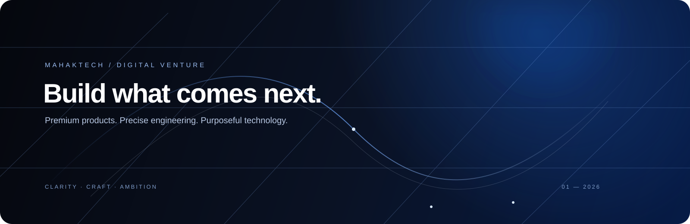
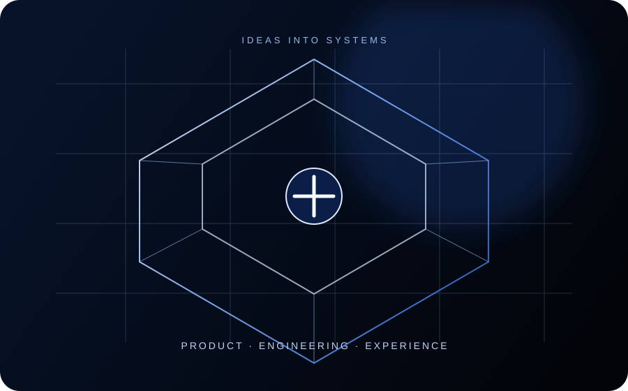

 

# MAHAKTECH

### **Technology with purpose. Built for what comes next.**

  <strong>Mahak</strong> · CEO & Founder

  <a href="https://mahak-tech-official-portfoilo.vercel.app">Website</a>
  &nbsp; <strong>·</strong> &nbsp;
  <a href="https://github.com/MahakTech/Mahak-tech-official-portfoilo">Portfolio</a>
  &nbsp; <strong>·</strong> &nbsp;
  <a href="https://github.com/MahakTech">GitHub</a>

 

<table>
  <tr>
    <td width="58%" valign="top">
      <h2>Building the next layer of digital</h2>
      
MahakTech is a technology venture focused on digital products, software, websites, and innovative technology solutions.

      
We combine <strong>clear product thinking</strong>, <strong>refined digital experiences</strong>, and <strong>modern engineering</strong> to turn ambitious ideas into useful, memorable products.

    </td>
    <td width="42%" valign="top">
      
    </td>
  </tr>
</table>

## A point of view

> The best technology is not defined by how complex it is. It is defined by how naturally it solves a meaningful problem.

Every MahakTech build starts with a real opportunity: understand the problem, shape the experience, engineer the foundation, and keep improving until the result feels inevitable.

## Ventures & products

<table>
  <tr>
    <td width="50%" valign="top">
      <h3>01 · MahakTech</h3>
      
<strong>Technology venture</strong>

      
Building digital products, software, websites, and innovative technology solutions with a focus on usefulness, quality, and long-term potential.

      
BUILDING IN PUBLIC

    </td>
    <td width="50%" valign="top">
      <h3>02 · Official Portfolio</h3>
      
<strong>Digital brand experience</strong>

      
The public digital home of MahakTech — designed to communicate the venture's identity, capabilities, and direction.

      
<a href="https://mahak-tech-official-portfoilo.vercel.app">Live experience</a> &nbsp;·&nbsp; <a href="https://github.com/MahakTech/Mahak-tech-official-portfoilo">Source</a>

    </td>
  </tr>
</table>

## Featured build

### Official Portfolio Experience

A motion-led portfolio platform designed to make the MahakTech vision tangible through a polished, responsive, and immersive web experience.

<table>
  <tr>
    <td width="33%" valign="top"><strong>Purpose</strong> Brand presentation Digital storytelling</td>
    <td width="33%" valign="top"><strong>Experience</strong> Responsive layouts Motion-led interactions</td>
    <td width="33%" valign="top"><strong>Built with</strong> Next.js · React TypeScript · Three.js</td>
  </tr>
</table>

  <a href="https://mahak-tech-official-portfoilo.vercel.app"><strong>Open live website →</strong></a>
  &nbsp;&nbsp;&nbsp;
  <a href="https://github.com/MahakTech/Mahak-tech-official-portfoilo">View repository</a>

## Technology direction

<table>
  <tr>
    <td width="33%" valign="top">
      <h4>INTERFACE</h4>
      Next.js · React 
      TypeScript · Tailwind CSS 
      Framer Motion · Lucide
    </td>
    <td width="33%" valign="top">
      <h4>IMMERSION</h4>
      Three.js · Lenis 
      Motion systems 
      Expressive digital experiences
    </td>
    <td width="33%" valign="top">
      <h4>DELIVERY</h4>
      GitHub · Vercel 
      ESLint · PostCSS 
      Modern web foundations
    </td>
  </tr>
</table>

<strong>How the stack is used</strong>

 

The stack is selected around the product — not the other way around. The focus is on fast, maintainable interfaces, purposeful motion, responsive design, and foundations that can evolve with the idea.

## Engineering & innovation

MahakTech explores the space where **useful software**, **secure systems**, and **expressive digital experiences** meet. Current work is grounded in modern web product development, with room to explore immersive interfaces and emerging technology as the right opportunities appear.

## GitHub, without the noise

Rather than filling the profile with fragile third-party widgets, explore the verified organization for the most current repositories and activity:

  <a href="https://github.com/MahakTech"><strong>Explore MahakTech on GitHub →</strong></a>

## Connect & collaborate

Have a thoughtful product, software, website, or technology idea worth building?

  <a href="https://mahak-tech-official-portfoilo.vercel.app"><strong>Website</strong></a>
  &nbsp;&nbsp;·&nbsp;&nbsp;
  <a href="https://github.com/MahakTech"><strong>GitHub</strong></a>
  &nbsp;&nbsp;·&nbsp;&nbsp;
  <a href="https://github.com/MahakTech/Mahak-tech-official-portfoilo"><strong>Portfolio repository</strong></a>

 

**Make it useful. Make it distinctive. Make it matter.**

© MahakTech · Building with ambition and intent.

